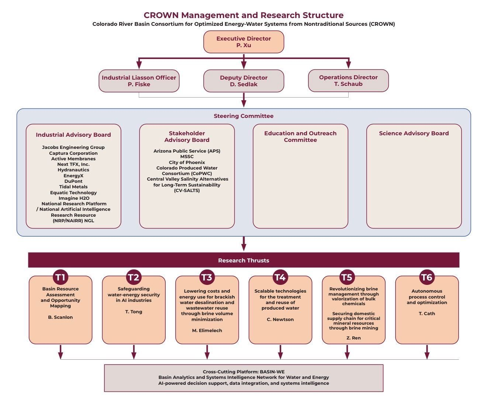
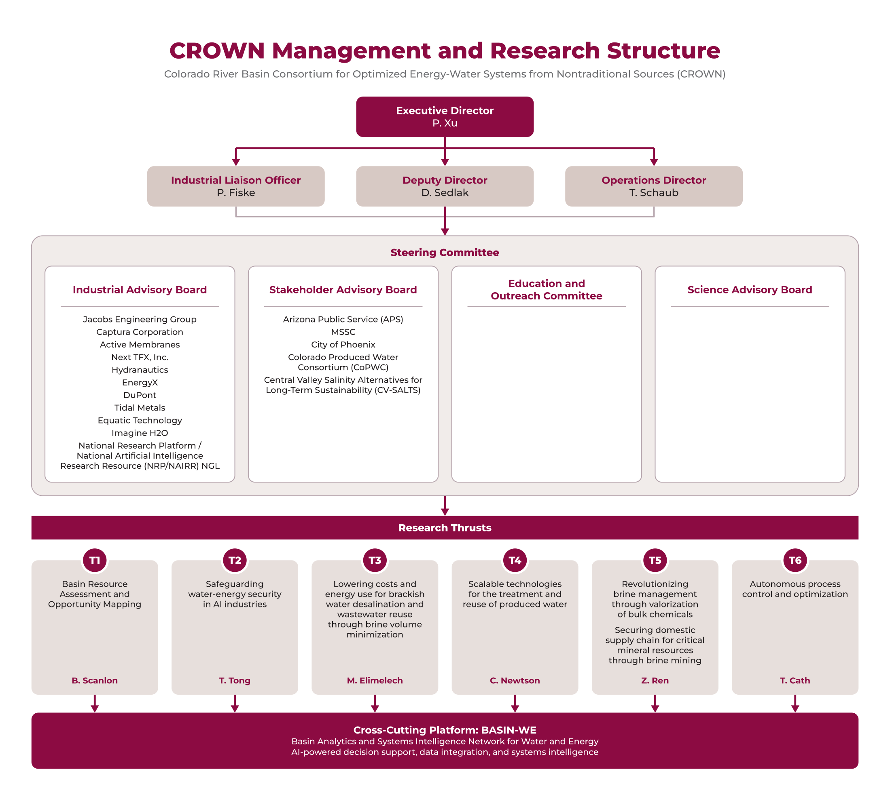

# deslop-marcomm

AI slop in, NMSU brand out.


People across campus are making charts, flyers and proposal figures with ChatGPT and other free AI tools, and then asking Marketing and Communications to "just clean them up." The content is usually what they need. Nearly everything else has to be redone: colors that aren't ours, fonts that aren't Gotham or an approved substitute, misspelled words, boxes that don't line up, and sometimes a made-up NMSU logo. Doing that by hand, one request at a time, is what's burying the department.

This repo hands the rebuild to Claude. You give it the image the requester sent. Claude transcribes the content and rebuilds the design from scratch in NMSU's colors and type. Then it checks the result against the rules on [brand.nmsu.edu](https://brand.nmsu.edu) and gives you a file to finish in Illustrator. Claude asks about anything it can't read, and it won't hand over anything that breaks the brand rules.

## Before and after

| What came in | What came back |
|---|---|
|  |  |

The only content change was one spelling fix, "Liasson" to "Liaison". Everything else was rebuilt:

- Aggie Crimson, with Desert Sand and Organ Mountain for the boxes
- Montserrat, NMSU's approved substitute for Gotham
- three type sizes, which is what NMSU asks for
- every line of text measured to fit its box

## What you get back

Every request ends up in its own folder under `jobs/`, with the original in `source/` and these files in `out/`:

- **An Illustrator build script (`.jsx`).** This is the one to use. In Illustrator, choose File > Scripts > Other Script... and pick it, and Illustrator builds a native document. The document has NMSU colors as global swatches, named layers, each box grouped with its text, and live centered type. Save As `.ai` and you're editing normally. If your machine has Gotham, open the `.jsx` in a text editor first and change `PREFER_GOTHAM = false` to `true`.
- **An SVG.** It opens straight in Illustrator and looks exactly right, but each line of text comes in as its own object.
- **A PDF.** It's ready to drop into a proposal, a Word document or a slide.
- **PNG previews,** including a grayscale one for NMSU's black-and-white check.

## What gets checked before anything comes out

Each check comes from the brand site, and if any of them fails, no files get written:

- **Only palette colors.** Everything uses the NMSU palette, and Sagebrush Mint is never used for text.
- **Crimson leads.** Aggie Crimson is present, and no accent color outweighs it.
- **Accents stay small.** Tertiary colors cover at most 20% of the color on the page, measured on the finished render.
- **Two or three type sizes,** and the same limit for weights.
- **Readable contrast.** Every line of text meets accessibility contrast against whatever sits behind it.
- **No overflow.** No text spills out of its box.
- **The Illustrator script matches.** It draws the same picture as the preview.

When a check fails, Claude has to change the design. The rules themselves only change when MarComm says so (see "Making it MarComm's" below).

## Setting up a computer (once)

On a Mac:

1. Install [Homebrew](https://brew.sh) if it isn't there yet.
2. In Terminal, run:
   ```sh
   brew install python node imagemagick
   brew install --cask inkscape
   ```
   Then open Inkscape once from Applications so macOS will let it run.
3. Install Claude Code. You can use the [desktop app](https://code.claude.com/docs/en/overview) (sign in, then use the **Code** tab), or the terminal version:
   ```sh
   curl -fsSL https://claude.ai/install.sh | bash
   ```
4. Get the repo and its Python pieces:
   ```sh
   git clone https://github.com/ryandward/deslop-marcomm.git
   cd deslop-marcomm
   python3 -m venv .venv
   .venv/bin/pip install -e ".[dev]"
   .venv/bin/pytest
   ```
   The last command should end with `7 passed`. That run builds and checks real files, so passing means everything is wired up.

If any step fails, open Claude Code in the `deslop-marcomm` folder and paste in the error. The instructions it reads from `CLAUDE.md` include the setup. Windows works too with the same tools, and Claude can walk you through it.

## Rebuilding something

1. Open Claude Code in the `deslop-marcomm` folder: run `claude` in Terminal, or pick the folder in the desktop app.
2. Drag in what the requester sent (a screenshot, image, PDF or slide), and say what it is. For example:
   > Engineering sent this advising flowchart. Rebuild it in NMSU brand as a job called eng-advising-flow.
3. Claude saves the original and types out every word. It asks you about anything it can't read or that looks garbled. It won't quietly change names, acronyms, numbers or dates, because AI tools mangle those in convincing ways.
4. Claude builds the design, runs the checks, looks at the preview itself, and tells you what changed from the original.
5. Ask for changes the way you'd tell a designer:
   > The third box should say Office of the Provost.

   > Tighten the spacing between the two rows.
6. If you want, ask Claude to draft the reply to the requester:
   > Write a short note to the requester explaining what changed.
7. Take the `.jsx` into Illustrator, Save As `.ai`, add the logo if the piece needs one, and send it off.

## What it doesn't do yet

- **Logos.** Claude doesn't place the logo. Add it in Illustrator from `brand/logos/` or your Brand Portal files, keeping the clear space and minimum size.
- **Multi-page documents.** Only single-page graphics are supported, so nothing for InDesign. Reports and decks are better started from NMSU's Word and PowerPoint templates.
- **Running Illustrator.** Claude doesn't run Illustrator itself. The `.jsx` is checked against a stand-in for Illustrator's scripting. If it ever throws an error in the real Illustrator, give Claude the exact message, and it knows how to fix the stand-in and the script together.

Some things it won't do on purpose, because the brand rules say not to:

- redraw, recolor or alter the logo
- set a department name next to the logo
- make AI images of campus

## Making it MarComm's

- **Your reading of the rules wins.** `BRAND.md` is our plain-language reading of brand.nmsu.edu. If a check enforces something differently from how MarComm means it, tell Claude. It updates the rules and records who decided and when, under "Decisions by MarComm" in `BRAND.md`.
- **Official logos.** The three logos in `brand/logos/` are the copies NMSU serves on its website. Put the official files from the Brand Portal in `brand/logos/portal/`.
- **Gotham.** If MarComm machines have Gotham, ask Claude to make Gotham the default in the Illustrator scripts.
- **Keep the repo private.** Jobs hold other people's unpublished work, like proposals, internal org charts and names. A private GitHub repo, or one inside an NMSU organization, keeps that inside the department.

## What's in here

- `CLAUDE.md`: the working instructions Claude reads automatically in this folder
- `BRAND.md`: the brand rules in plain language, with links to the brand site
- `brand/`: Montserrat and Open Sans fonts, NMSU logo files, and swatch libraries for Illustrator, InDesign and Inkscape (`brand/swatches/`)
- `jobs/`: one folder per request
- `nmsu/`: the rebuilding toolkit, so Claude can explain any part of it if you're curious
- `reference/brand-site/`: dated copies of the brand site pages the rules come from
- `tests/`: proof that the checks reject off-brand work

Montserrat and Open Sans are free fonts under the SIL Open Font License. The NMSU logo files are NMSU trademarks, used under NMSU's brand guidelines.
